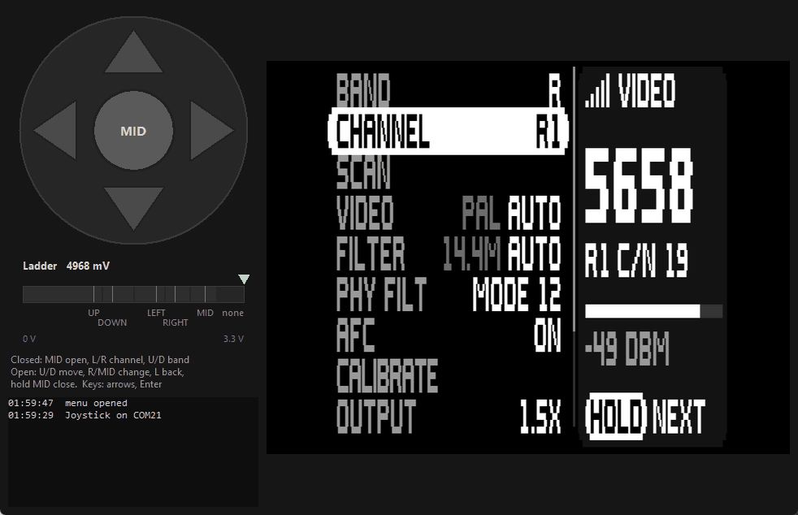

# Joystick menu mock (DO NOT MERGE)

> **Demo only, not for merging.** This is a bench experiment shared for
> discussion: what the C5VRX menu could feel like with a 5-way joystick
> instead of the single BOOT button. Nothing here changes the receiver
> firmware, and the receiver is not involved at all.



An ESP32-S3 Super Mini reads an SKRHABE010 5-way switch through a resistor
ladder on one ADC pin and reports presses over USB serial. A desktop app shows
the joystick live and drives a mock of the C5VRX menu with it.

The menu picture is the real one. `main/menu_ui.c` is compiled for the host
and shown through `tools/menu_preview.py`, the same way the goggle previews
are made. Only the receiver behind it is simulated: signal, scan, calibration,
filter and gain. Any change to `main/menu_ui.c` shows up the next time the
mock starts.

## What's here

| File | What it does |
|---|---|
| `firmware/` | PlatformIO project for the ESP32-S3 Super Mini. The `joystick` build reads the ladder; `gpioscan` finds which pad it is wired to. |
| `menu_mock.py` | The app: joystick view, ladder meter and the C5VRX menu. Works with the keyboard alone if you have no hardware. |
| `menu_shim.c` | Lets Python call `main/menu_ui.c`. The mock compiles it into `build/` automatically. |
| `ladder_check.py` | Guided test: press each direction when asked, then get a report of the measured levels. |
| `gpio_gui.py` | Live view of every GPIO, for finding the pad the ladder is really on. |

## Hardware

- ESP32-S3 Super Mini (4 MB flash, native USB)
- SKRHABE010 (Alps) 5-way switch: UP, DOWN, LEFT, RIGHT, MID (push) and a common pin
- Resistors: 10k (pull-up), 4.7k, 6.8k, 10k + 5.1k in series, 22k, 47k

### Wiring

Each direction connects the ADC node to GND through its own resistor, so the
direction can be read from the voltage alone:

```
3V3 ──[10k]──┬──────────────────────── GPIO11 (ADC)
             │
             ├──[4.7k]──────── UP    ─┐
             ├──[6.8k]──────── DOWN  ─┤
             ├──[10k]─[5.1k]── LEFT  ─┤  switch contacts
             ├──[22k]───────── RIGHT ─┤
             └──[47k]───────── MID   ─┘
                                     │
                                    COM ── GND
```

Check the switch's datasheet, or use a continuity tester, to see which pin is
which direction. COM has to reach the board's GND: if it doesn't, the pin sits
at 3.3 V and no press registers.

| Pressed | Resistor to GND | Node voltage | Firmware upper bound |
|---|---|---|---|
| UP | 4.7k | 1.06 V | 1195 mV |
| DOWN | 6.8k | 1.34 V | 1660 mV |
| LEFT | 15.1k | 1.98 V | 2125 mV |
| RIGHT | 22k | 2.27 V | 2495 mV |
| MID | 47k | 2.72 V | 2900 mV |
| nothing | (open) | 3.30 V | above that |

The bounds are midpoints between neighbouring levels. The S3's ADC tops out
around 3.1 V, so "nothing pressed" reads full scale. On GPIO11 the firmware's
mV conversion reports 4968 mV there; that is a clamping artefact, not a real
voltage.

### Which pin

The firmware reads `LADDER_PIN`, set in `firmware/platformio.ini` (default 11).

- **Check the pad number.** On the board this was built with, the pad counted
  as GPIO12 from the pinout picture was actually GPIO11. If nothing responds,
  flash `gpioscan` and run `gpio_gui.py` (see Testing, step 1). It shows which
  pad is connected.
- **Wi-Fi.** GPIO11-20 are on ADC2, which Wi-Fi also uses. That's fine for
  this bench rig, which has no Wi-Fi. For anything that runs Wi-Fi, use GPIO1-10
  (ADC1) and change `LADDER_PIN`.

## Software

- PlatformIO, for the firmware (`espressif32@6.9.0`, Arduino)
- Python 3.8 or later with tkinter, plus `pip install numpy pillow pyserial`
- A C compiler on PATH (`gcc`, `cc` or `clang`) for the menu renderer. On
  Windows, MinGW-w64 gcc works, for example from MSYS2 or Strawberry Perl.

## Testing

Run the commands from the repository root. Replace `PORT` with the board's
serial port, for example `COM21` or `/dev/ttyACM0`. Only one program can have
the port open at a time, so close the GUIs before flashing.

### 1. Find the pad (optional, if presses don't register)

```
pio run -d tools/joystick_menu/firmware -e gpioscan -t upload
python tools/joystick_menu/gpio_gui.py PORT
```

Every GPIO gets a tile. A pin with nothing on it shows as **floating**
(grey). The ladder pin shows as **tied high** (red) because of the 10k
pull-up. Press the switch: the ladder pin's voltage steps down, its tile
lights up yellow and the change is logged.

### 2. Check the levels

With `gpioscan` still flashed:

```
python tools/joystick_menu/ladder_check.py PORT 11
```

Keep your hands off for the idle reading, then hold each direction when asked.
For each direction the report shows the raw ADC count next to the mV reading,
so a wiring fault can be told apart from a calibration problem. It also
suggests raw thresholds and saves a copy to `build/ladder_check_result.txt`.
The build this was written with measured:

| Button | Expected | Measured | Raw count |
|---|---|---|---|
| UP | 1.06 V | 1.045 V | 1225 |
| DOWN | 1.34 V | 1.333 V | 1572 |
| LEFT | 1.98 V | 1.963 V | 2327 |
| RIGHT | 2.27 V | 2.272 V | 2708 |
| MID | 2.72 V | 2.723 V | 3314 |

The smallest gap between levels was 347 raw counts, against about ±5 of noise.

### 3. Flash the joystick firmware

```
pio run -d tools/joystick_menu/firmware -e joystick -t upload
pio device monitor -b 115200
```

It prints `press UP 1052 mV (expected 1055)` and `release UP`. The onboard
RGB LED changes colour for each direction. Serial commands:

| Key | Does |
|---|---|
| `r` | stream the raw mV reading |
| `s` | per-button press counts, min/max mV and margin to the bounds |
| `c` | clear those stats |

Once all five directions have been seen, it prints the stats table by itself.

### 4. Run the menu mock

```
python tools/joystick_menu/menu_mock.py PORT
python tools/joystick_menu/menu_mock.py            keyboard only, no hardware
```

It boots with the C5VRX splash, then shows a stand-in for live video. The
real receiver has one button (press = next row, hold = change it); the mock
spreads that over five directions:

| | Menu closed | Menu open |
|---|---|---|
| UP / DOWN | change band | move through the list (it scrolls past nine rows) |
| LEFT / RIGHT | change channel | LEFT steps the value back, RIGHT forward |
| MID | open the menu | change the item, or run it (SCAN, CALIBRATE, EXIT) |
| Hold MID (0.6 s) | | close the menu |

- **CALIBRATE:** MID opens the QUICK / FULL / BACK submenu. UP/DOWN move in
  it, MID starts the selected item, LEFT leaves.
- **Auto-repeat:** holding UP, DOWN, LEFT or RIGHT repeats.
- **Idle:** the menu closes after 30 s without input, as in the firmware.
- **Keyboard:** arrow keys, plus Enter or space for MID.

What to check:

- [ ] Each direction lights its arrow, and the ladder needle sits in that
      direction's zone.
- [ ] UP/DOWN walk through all twelve items and the list scrolls.
- [ ] LEFT/RIGHT cycle BAND, CHANNEL, VIDEO, FILTER, PHY FILT, AFC, OUTPUT
      and GAIN both ways.
- [ ] SCAN sweeps the bands and lands on R1, the strongest simulated VTX.
- [ ] CALIBRATE > QUICK shows the calibration screen with a progress bar,
      then returns to live video. BACK and LEFT leave the submenu.
- [ ] Holding MID closes the menu. EXIT closes it too.

## What's simulated

| Thing | In the mock |
|---|---|
| Menu picture | the real `main/menu_ui.c`, shown through `tools/menu_preview.py` |
| Channel table, band names, output levels, gain modes | copied from `main/rf.c`, `main/transport.c` and `main/receiver.c` |
| Signal, dBm, C/N | made up. Pretend VTXs sit on R1, R4 and A2. |
| Filter widths, VTX deviation, AFC offset | made-up but plausible values |
| Calibration | timed screens only, nothing is measured |
| DAC TEST | the page shows, but the meter steps aren't simulated |
| Live video | a grey placeholder, or snow when there's no signal |

`menu_shim.c` copies a plain ints-and-strings struct into `menu_view_t`. If a
field is added to `menu_view_t`, it stays zero in the mock until it's added to
both the shim and `ShimView` in `menu_mock.py`. If `main/menu_ui.h` gains or
loses items, the mock refuses to start and says so.
